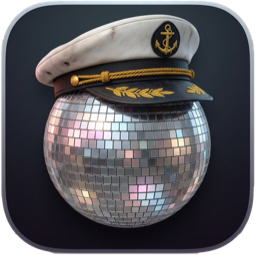
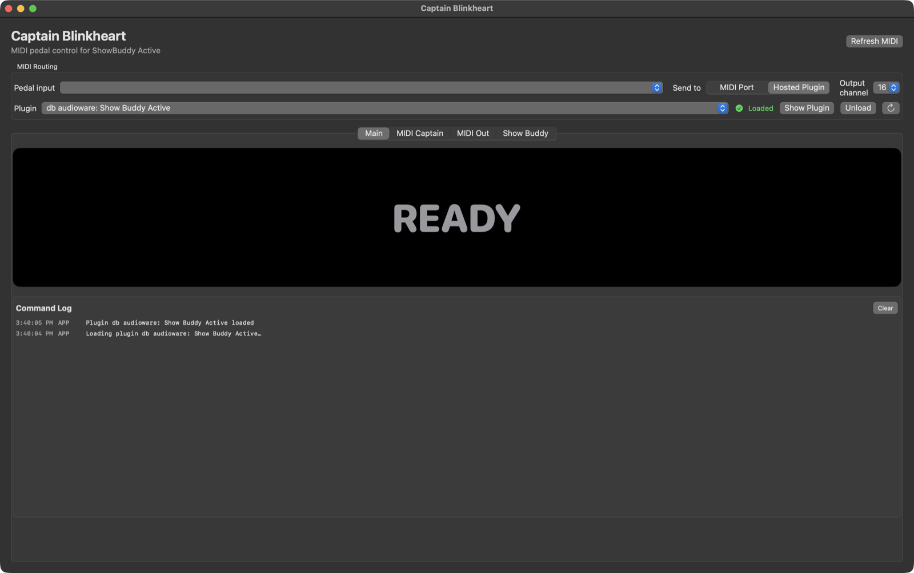
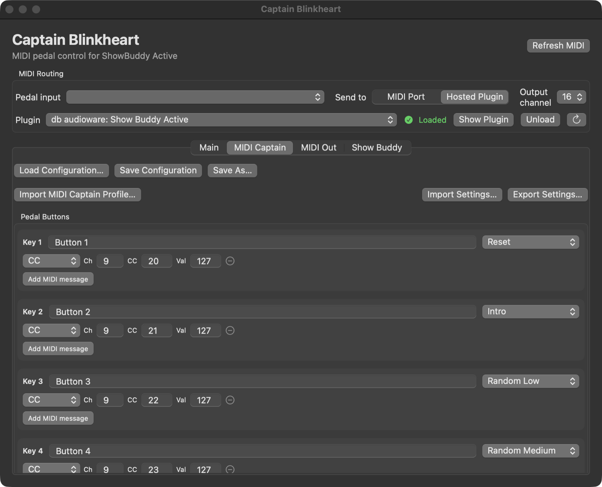
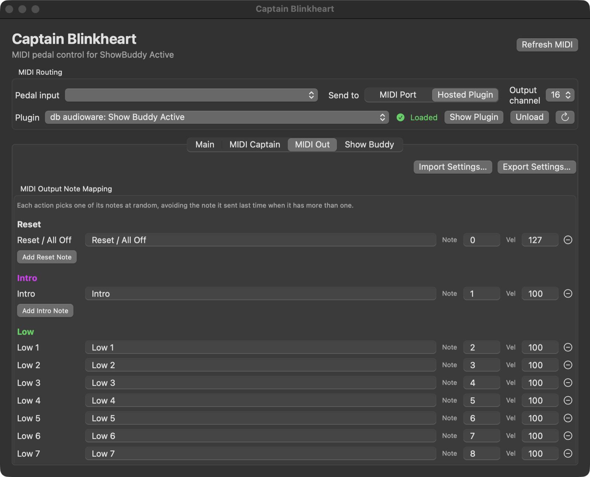

<p align="center">
  
</p>

<h1 align="center">Captain Blinkheart</h1>

<p align="center">
  <strong>Foot-switch your stage lighting.</strong><br>
  A native macOS bridge from a MIDI Captain pedal to Show Buddy Active lighting scenes.
</p>

<p align="center">
  <a href="LICENSE"></a>
  
  
  
</p>

<p align="center">
  
</p>

Captain Blinkheart turns presses on a six-button MIDI Captain MINI6 pedal into
lighting cues. Each button picks an action (Reset, Intro, Low, Medium, High or
Frenzy), and each action picks a random scene from its own list of MIDI notes,
so the lights keep changing without repeating the same look. Cues go to
[Show Buddy Active](https://www.dmxis.com/show-buddy-active/) by DB Audioware running right inside the app, or
to any CoreMIDI port.

> [!IMPORTANT]
> **Show Buddy Active is not part of this project.** It is owned and developed by
> [DB Audioware](https://www.dmxis.com/show-buddy-active/), and all rights to it belong to them. Josh Hanson and
> this project own none of the rights to Show Buddy Active, and Captain
> Blinkheart neither includes nor redistributes it. Captain Blinkheart is meant
> to be used by **licensed Show Buddy Active users**, who host their own
> licensed copy of the plugin inside the app.

## Features

- **Hosts Show Buddy Active** as an Audio Unit, with its own screen in a
  **Show Buddy** tab. No DAW or IAC bus needed.
- **Random scenes for every action.** Each action picks from its own list of
  notes and avoids repeating the last pick.
- **Record songs and play them back.** Record a song's cues once
  in rehearsal, arrange songs into a playlist, then let the pedal run the show:
  Start fires each song's cues on time against the band's click.
- **Take the show to a Raspberry Pi.** Record every Show Buddy scene over
  Art-Net and export it to a USB stick for the [stage Pi player](pi/), so a
  gig needs only a pedalboard case, not a laptop.
- **Explicit, editable pedal rules.** Match note and CC messages by channel,
  number and value, including ordered multi-message buttons.
- **Live feedback.** A large color-coded action display and an in/out command
  log.
- **Portable settings.** Load, save, import and export JSON configurations, or
  import the pedal's own text profile. An automatic recovery copy is kept.
- **Native and lightweight.** SwiftUI, CoreMIDI and AVFoundation, with no third-party
  dependencies. Universal binary for Apple silicon and Intel.

## Screenshots

| MIDI Captain: pedal button rules | MIDI Out: scene notes per action |
|---|---|
|  |  |

## Install

Download **Captain-Blinkheart-1.0.pkg** from the
[latest release](../../releases/latest) and open it. The installer is signed
and notarized by Apple and puts **Captain Blinkheart** in `/Applications`. It
runs on macOS 12 or later, on Apple silicon and Intel Macs. To build it
yourself instead, see [Run and build](#run-and-build).

To host Show Buddy Active in the app, you need your own licensed copy,
purchased separately from [DB Audioware](https://www.dmxis.com/show-buddy-active/) and installed as an Audio Unit.

## Included MIDI Captain profile

[`Sources/SceneBridgeCore/Resources/MIDI-Captain-MNDL-page0.txt`](Sources/SceneBridgeCore/Resources/MIDI-Captain-MNDL-page0.txt)
is the bundled plain-text MIDI Captain page. On a fresh install, Captain Blinkheart
parses each key's `short_dw1` messages and creates these scene-action mappings:

| MIDI Captain key | Trigger messages | Captain Blinkheart action |
|---|---|---|
| 0 | Note 0, ch 16; CC 35=127 and CC 30=3, ch 15 | Reset |
| 1 | Note 23, ch 16 | Intro |
| 2 | Note 19, ch 16 | Random Low |
| 3 | CC 18=127 then CC 20=127, ch 2 | Random Medium |
| 4 | CC 18=0 then CC 20=127, ch 2 | Random High |
| 5 | CC 18=127 then CC 20=0, ch 2 | Random Frenzy |

Each key uses `ledmode = [select1]` in the same selection group. `ledcolor0`
sets the one-LED idle color, `ledcolor1` sets the selected three-LED color,
and `LEDSelectLowLight` keeps unselected keys dim instead of turning them off.
`LowLightLevel = [10]` follows PaintAudio's documented example. The `select1`
mode is selection feedback, not a documented animation; test the profile on
the pedal to confirm the firmware's exact LED transition.

For multi-message keys, Captain Blinkheart matches the configured messages in order
within 1.5 seconds before triggering. The pedal button panel lets you change
each key's action and message sequence. Import accepts the MIDI Captain text
page as well as a Captain Blinkheart JSON configuration. Imported text replaces the
button rules while keeping the app's configured ShowBuddy scene notes.

The starter note numbers are examples. Replace them with ShowBuddy's mapped
notes in Captain Blinkheart's MIDI Out tab. Random picks avoid repeating the previous
scene in that intensity group when it contains multiple scenes.

## Run and build

Requirements: macOS 12.0 or later and Swift 5.9 or later. The packaging script
cross-builds both arm64 and x86_64 slices and verifies the resulting universal
binary with `lipo`.

```sh
swift test
swift run
```

To package a launchable `.app` bundle:

```sh
chmod +x scripts/build-app.sh
./scripts/build-app.sh
open "dist/Captain Blinkheart.app"
```

To build a signed installer that puts the app in `/Applications`:

```sh
./scripts/build-pkg.sh            # builds the app, then dist/Captain-Blinkheart-<version>.pkg
NOTARY_PROFILE=<profile> ./scripts/build-pkg.sh   # also notarizes and staples it
```

The scripts sign with the first "Developer ID Application" and "Developer ID
Installer" certificates in your keychain (override with `APP_SIGN_IDENTITY` /
`PKG_SIGN_IDENTITY`), and fall back to ad-hoc/unsigned without them. A signed
app uses the hardened runtime, and
`scripts/CaptainBlinkheart.entitlements` disables library validation so it can
load Show Buddy Active, which another developer signed. Without notarization,
Gatekeeper rejects the package when it's downloaded. Create a notarization
profile once with `xcrun notarytool store-credentials <profile>`.

The app icon comes from `captain_blinkheart_icon.png` in the project root. The
build script runs `scripts/make-icon.swift`, which crops the art inside its
silver rim and clips it to Apple's continuous-corner tile on the standard
1024 px icon grid (824 px tile, transparent margins, no shadow). macOS 26
shrinks icons of any other shape onto a gray tile. `sips` and `iconutil` then
build `AppIcon.icns`. The crop is measured from this artwork, so update
`interior` in the script if the art's layout changes.

## Connect ShowBuddy Active

### Option A: host the plugin inside Captain Blinkheart

Show Buddy Active's Audio Unit (`aumf DmpP dBau`) can run inside the app, so no
IAC bus or DAW is needed. This is the recommended setup, and it requires an
installed, licensed copy of [Show Buddy Active](https://www.dmxis.com/show-buddy-active/) from DB Audioware.
Captain Blinkheart loads the plugin you have installed; it doesn't include,
unlock or modify it.

1. Select the MIDI Captain as **Pedal input**.
2. Set **Send to** to **Hosted Plugin**. The app loads Show Buddy Active
   automatically; choose another installed instrument or music effect from the
   **Plugin** menu if needed.
3. Open the **Show Buddy** tab (or click **Show Plugin**) to use Show Buddy's
   own screen and set up your show.
4. Map the output note numbers in the MIDI Out tab to Show Buddy scenes.

The plugin's settings are stored in the configuration (`pluginState`) when you
save, switch back to MIDI Port, unload the plugin, or quit, and restored when it
is loaded again. Only Audio Units are supported; VST/VST3 hosting is not.

### Option B: send to ShowBuddy over a MIDI port

1. In Audio MIDI Setup, create and enable an IAC Driver bus (or select another
   virtual MIDI output that ShowBuddy can receive).
2. Connect the MIDI Captain over USB and select it as **Pedal input**.
3. Select the IAC bus as **ShowBuddy output** and configure the same channel in
   ShowBuddy Active.
4. Map the configured output note numbers to the desired ShowBuddy scenes.
5. Test each pedal button and confirm its MIDI messages in Command Log.

## Songs and playback

Live mode, where each pedal key fires its lighting action, stays the default.
Songs and playback build on top of it for shows played to a metronome.

1. **Record a song.** In the **Songs** tab, click **New Song**, name it, and
   click **Record**. The app switches to live mode and waits. Play the song with
   the pedal as usual: the first cue you press becomes time 0:00, and every
   later press is timed from it. Click **Stop & Save** when you're done.
   Recording saves the *actions* (Intro, Low, High and so on), not specific
   notes, so each playback picks fresh random scenes from the MIDI Out lists.
2. **Fine-tune.** Edit any cue's time (in seconds) or action, delete stray cues,
   and click **Preview** to play the song.
3. **Build the playlist.** Add songs with the playlist button next to each song,
   reorder them with the arrows, and click an entry to make it the next song.
   A song can appear more than once.
4. **Perform.** Switch **Mode** to **Playback**. The Main tab shows the current
   song, its elapsed time and the next song in large type. Press **Start** on
   the beat where you'd have pressed the first cue: it fires right away and the
   rest follow on their recorded times. When a song's last cue has fired, the
   next song is ready.

In playback mode, each pedal key runs a playback command, which you can change
per key in the **MIDI Captain** tab. Defaults follow the key's live action:

| Live action | Playback command | What it does |
|---|---|---|
| Reset | Reset | Stops the song and sends the Reset cue; stays on the song |
| Intro | Start | Starts the current song (ignored while one is playing) |
| Low | Stop | Stops the song; stays on the song |
| Medium | Previous Song | Stops and moves to the previous song |
| High | Next Song | Stops and moves to the next song |
| Frenzy | Live Cue | Fires the key's live action, for a manual override |

Songs and the playlist are stored in the configuration file and its recovery
copy, so there are no extra files to manage. They're also included in
exported settings. While playback mode is on, the app opts out of App Nap so
cue timing holds with its window in the background. Cues are scheduled against
a fixed start time, so they don't drift over a long song.

## Stage Pi export

The [`pi/`](pi/) folder holds a stage player for a Raspberry Pi with a
touchscreen and its own USB-DMX box. Captain Blinkheart records the scenes for
it from Show Buddy Active:

1. In Show Buddy's DMX output settings, choose **Art-Net**, IP address
   **127.0.0.1**, broadcast **off**. Show Buddy Active supports Art-Net output.
2. In the **Stage Pi** tab, turn on **Receive Art-Net from Show Buddy** and pick
   your Enttec box under **Light preview**, so your lights keep following
   Show Buddy while you design.
3. Set each group's fade for the Pi (Intro and Low 2.5 s, Medium 1.5 s, High
   0.6 s, Frenzy 0.2 s and Reset instant by default).
4. Click **Export to Pi…** and choose a USB stick. The app fires every note in
   each pedal key's list, records Show Buddy's DMX, and writes a `blinkheart`
   folder: `show.json` plus `switch-1/`, `switch-2/`, … with one `.fseq` file per
   scene. Keep the app open while it records: about 22 seconds per scene at
   the defaults, so a 34-scene show takes about 13 minutes.

Show Buddy's chases rarely repeat exactly, so each scene is recorded for 20
seconds by default and its end is blended into its start to make a smooth
loop. Scenes that don't move are saved as a single look. To change only
labels, MIDI, or fades, use **Update Settings Only…**, which keeps the
recordings.

The [stage guide](pi/README.md) covers setting up the Pi, loading shows,
playing from the footswitches, and changing the configuration.

## Configuration

The app loads the bundled profile on first launch, then automatically keeps a
recovery copy at `~/Library/Application Support/SceneBridge/MIDI-Captain-6-Button.json`.
Use **Load Configuration**, **Save Configuration**, and **Save As** in the MIDI
Captain tab to manage JSON configuration files. The app reopens the last loaded
or saved file on launch; if it is unavailable, the recovery copy is used.
**Import MIDI Captain Profile** also accepts the pedal's plain-text profile.

**Export Settings…** and **Import Settings…** (MIDI Captain and MIDI Out tabs,
or File ▸ Export/Import Pedal & MIDI Settings, ⇧⌘E / ⇧⌘I) move the pedal button
rules and MIDI settings between machines or setups. The exported file leaves
out the hosted plugin and its state; importing keeps your current plugin
setup, and keeps your current MIDI ports if the file doesn't name any. A full
configuration file can also be imported this way.
Configurations include endpoint IDs when selected, per-message channel/button
rules, the output target and hosted plugin state, and a list of note/velocity
cues for every action, recorded songs and the playlist. Reset and Intro pick randomly from their lists just like
Low, Medium, High, and Frenzy. Older files with a single `resetCue` and
`baselineCue` are migrated automatically.

## Project layout

| Path | Contents |
|---|---|
| `Sources/SceneBridgeCore` | Platform-independent models: configuration, pedal profile parsing, rule matching, random scene selection |
| `Sources/SceneBridgeApp` | SwiftUI app, CoreMIDI service, Audio Unit plugin host |
| `Tests/SceneBridgeAppTests` | Unit tests for the core logic |
| `scripts/` | App bundle, icon and installer build scripts |

## Contributing

Issues and pull requests are welcome. Please describe the pedal, macOS version
and output target (hosted plugin or MIDI port) when reporting a problem, and
include the relevant Command Log lines if you can. Run `swift build` (and
`swift test` with Xcode installed) before opening a pull request.

## License

Copyright (C) 2026 Josh Hanson.

Captain Blinkheart is free software: you can redistribute it and/or modify it
under the terms of the [GNU Affero General Public License](LICENSE) as
published by the Free Software Foundation, either version 3 of the License, or
(at your option) any later version. It is distributed in the hope that it will
be useful, but WITHOUT ANY WARRANTY; without even the implied warranty of
MERCHANTABILITY or FITNESS FOR A PARTICULAR PURPOSE.

### Third-party software and trademarks

[Show Buddy Active](https://www.dmxis.com/show-buddy-active/) is software owned by DB Audioware. All rights to
it, including its name, code and user interface, belong to DB Audioware. Josh
Hanson owns none of the rights to Show Buddy Active, and the AGPL license above
covers only Captain Blinkheart's own code. Captain Blinkheart doesn't include
or redistribute Show Buddy Active. The intended use is by licensed Show Buddy
Active users, hosting their own licensed copy of the plugin in Captain
Blinkheart under DB Audioware's license terms.

MIDI Captain is a trademark of its owner, Paint Audio. Captain Blinkheart is an
independent project and is not affiliated with or endorsed by DB Audioware or
Paint Audio.
