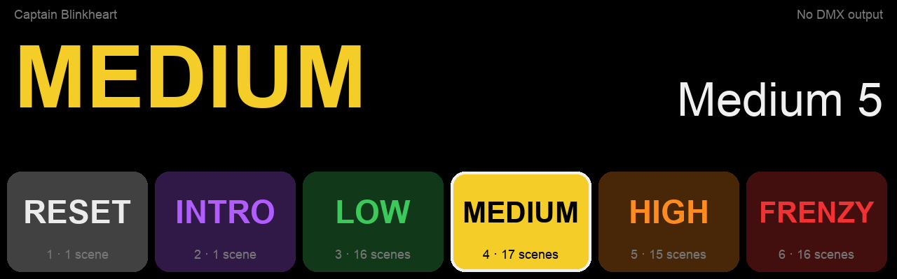

# Captain Blinkheart Pi: stage guide

Captain Blinkheart Pi turns a Raspberry Pi with a touchscreen into a
pedalboard lighting player. You design scenes in Show Buddy Active on your
Mac, Captain Blinkheart records them, and the Pi plays them on stage from your
footswitches. On stage there's no laptop, just the Pi, its USB-DMX box, and
your pedal: plug it in, wait for the screen, and play.

```
 AT HOME (Mac)                                         ON STAGE (Pi in the pedal case)
 Show Buddy ─Art-Net─▶ Captain Blinkheart                MIDI Captain ─USB─┐
                          │ Export to Pi…                                  ▼
                          └──────────▶ USB stick ──────▶ Raspberry Pi ─USB─▶ Enttec ─DMX─▶ lights
```

Show Buddy Active is software by [DB Audioware](https://www.dmxis.com/show-buddy-active/).
It isn't part of this project and doesn't run on the Pi: the Pi plays
recordings of the DMX that your own licensed copy produces.

**Contents**

1. [What you need](#1-what-you-need)
2. [Set up the Pi (once)](#2-set-up-the-pi-once)
3. [Export your scenes from the Mac](#3-export-your-scenes-from-the-mac)
4. [Load the show onto the Pi](#4-load-the-show-onto-the-pi)
5. [On stage: plug in and play](#5-on-stage-plug-in-and-play)
6. [Change the configuration](#6-change-the-configuration)
7. [Update the Pi software](#7-update-the-pi-software)
8. [Troubleshooting](#8-troubleshooting)
9. [Reference](#9-reference)

---

## 1. What you need

| Item | Notes |
|---|---|
| Raspberry Pi 3B+ or newer | A 3B+ is plenty. |
| microSD card, 8 GB or larger | A good-quality card (A1/A2 rated) boots faster. |
| Touchscreen | Any size or shape. Bar screens such as 1280×400 suit a pedal case. A portrait-mounted panel is turned sideways automatically. |
| Enttec **DMX USB Pro** (recommended) or **Open DMX USB** | The Pi detects which one it is. One box is enough: use it on the Mac while designing and move it to the Pi for gigs. |
| USB MIDI pedal | The MIDI Captain, connected by USB. |
| Power | The Pi and screen need **5 V at about 3 A**. Pedalboard supplies give 9 V, so use a 9 V → 5 V converter or a supply with a 5 V USB output. A weak supply causes random reboots. |
| A Mac with Show Buddy Active and Captain Blinkheart | To design and export the scenes. |

**Operating system:** Raspberry Pi OS Lite (64-bit), the current release
(Bookworm or newer). "Lite" means no desktop: nothing starts except what the
player needs, so the Pi boots quickly and shows nothing but the player.

## 2. Set up the Pi (once)

You'll need a network connection for this part only. Gigs don't need one.

### 2.1 Write the SD card

1. Install [Raspberry Pi Imager](https://www.raspberrypi.com/software/) on your Mac and open it.
2. **Device:** your Pi model (for example Raspberry Pi 3).
3. **Operating system:** *Raspberry Pi OS (other)* → **Raspberry Pi OS Lite (64-bit)**.
4. **Storage:** the SD card.
5. Click **Next** → **Edit settings** and set:
   - **Hostname:** `blinkheart`
   - **Username and password:** your choice (you'll use them to log in)
   - **Wireless LAN:** your Wi-Fi network (for installing; not needed at gigs)
   - **Locale:** your time zone and keyboard
   - **Services** tab: turn on **Enable SSH** with password authentication
6. Save, then write the card.

### 2.2 Screen settings (only if your screen needs them)

Some bar-shaped screens need extra lines in the Pi's `config.txt` (their
maker's instructions list them, usually `hdmi_` or `dtoverlay=` lines). With
the SD card still in your Mac, open the **bootfs** drive, open `config.txt`
in TextEdit, and add the lines at the end. Most HDMI screens with USB touch
need nothing.

### 2.3 Install Captain Blinkheart Pi

1. Put the SD card in the Pi, connect the screen, and power it on. The first
   boot takes a few minutes while the Pi sets itself up.
2. On your Mac, open **Terminal** and log in to the Pi (use your username):

   ```sh
   ssh yourname@blinkheart.local
   ```

3. Download Captain Blinkheart and run the installer:

   ```sh
   sudo apt install -y git
   git clone https://github.com/scooterhanson/Captain-Blinkheart.git
   cd Captain-Blinkheart/pi
   sudo ./install.sh
   ```

   No internet on the Pi? Copy the `pi` folder from your Mac instead:
   `scp -r pi yourname@blinkheart.local:` and then run
   `cd pi && sudo ./install.sh`.

4. Restart: `sudo reboot`. The screen should stay black, then show the
   Captain Blinkheart display (READY, with "Copy a show to a USB stick and
   plug it in"). No logos, text, or login prompt should appear.

**What the installer does**

- Installs the player (Python with pygame, pyserial, and python-rtmidi) in `/opt/blinkheart`.
- Starts it automatically at power-on, before anything else needs the screen,
  and restarts it within a second if it ever stops.
- Makes the boot silent: no rainbow screen, Raspberry Pi logos, boot text,
  blinking cursor, or login prompt.
- Turns off automatic package updates and maintenance jobs, so nothing runs
  in the background during a show.
- Creates the `blinkheart-pi` folder on the SD card's boot partition for the
  show and settings. A Mac can open this partition (it appears as **bootfs**).

### 2.4 Make it safe to unplug (do this last)

Once a show is loaded and everything works (section 4), turn on the
**read-only system**. The Pi then never writes to its system files, so pulling
the power at the end of a gig can't corrupt the SD card:

```sh
sudo blinkheart-readonly on
sudo reboot
```

Loading new shows still works with it on: the show and settings live on the
boot partition, which is only written while a show is loading. To install
updates, turn it off first (section 7). Check it any time with
`blinkheart-readonly status`.

## 3. Export your scenes from the Mac

### 3.1 One-time setup

1. **Show Buddy Active:** in its DMX output settings, where you'd normally
   choose your Enttec box, choose **Art-Net** instead. Set the IP address to
   **127.0.0.1** and turn **broadcast off**. Show Buddy now sends its lighting
   data to Captain Blinkheart instead of straight to the box.
2. **Captain Blinkheart:**
   - Set **Send to** to **Hosted Plugin** so it drives its own copy of Show
     Buddy.
   - Open the **Stage Pi** tab and turn on **Receive Art-Net from Show Buddy**.
     The status should show **Receiving … frames/s**.
   - Under **Light preview**, choose your Enttec box and its type. Captain
     Blinkheart passes Show Buddy's output through to it, so your lights work
     exactly as before while you design. When the box is at the Pi, set this
     to **None**.

### 3.2 What goes on which switch

Each pedal key becomes one switch folder on the Pi, in pedal order:
`switch-1`, `switch-2`, and so on. A switch's scenes are the notes in its
action's list on the **MIDI Out** tab. With the standard MIDI Captain
profile:

| Footswitch | Action | Scenes recorded | On the Pi |
|---|---|---|---|
| 1 | Reset | the Reset note | Always the same look, instant |
| 2 | Intro | every Intro note | Random pick, 2.5 s fade |
| 3 | Low | every Low note | Random pick, 2.5 s fade |
| 4 | Medium | every Medium note | Random pick, 1.5 s fade |
| 5 | High | every High note | Random pick, 0.6 s fade |
| 6 | Frenzy | every Frenzy note | Random pick, 0.2 s fade |

The **Export** section of the Stage Pi tab lists exactly what will be
written: each folder, its action, how many scenes, and its fade.

### 3.3 Set the fades

In **Fades on the Pi**, each group either uses the **Default fade** or has
**Own fade** checked with its own time in seconds. Calm groups should fade
slowly and intense ones quickly. Reset is instant by default.

### 3.4 Export

1. Plug a USB stick into the Mac. Any stick works, including the
   standard FAT/exFAT format.
2. In the Stage Pi tab, click **Export to Pi…**, choose the stick, and click
   **Export Here**.
3. Wait. Captain Blinkheart fires each scene in turn and records it, about
   22 seconds per scene (the tab shows the time remaining). Leave the app open.
   Your lights follow along if the preview is on.
4. When it says **Exported N scenes…**, eject the stick.

The stick now has a `blinkheart` folder. If you cancel or something fails,
the show already on the stick is left untouched.

**How scenes are recorded:** Show Buddy's chases rarely repeat exactly, so
each is recorded for 20 seconds (adjustable under **Recording**). Captain
Blinkheart then finds the point where the chase best matches its start and
blends the end into the beginning, so the loop plays without a visible
restart. Chases that do repeat exactly loop perfectly, and scenes that don't
move are saved as a single still look.

### 3.5 Changed only labels, MIDI, or fades?

Click **Update Settings Only…** and choose the stick. Only the settings file
is rewritten, and the recordings are kept, so it takes a second instead of a
full recording. If you've added or removed notes in a list, it tells you which
group needs a full export.

## 4. Load the show onto the Pi

### Option A: USB stick (usual)

1. With the Pi running, plug the stick into it.
2. The screen asks **Load show "…"?** with the number of switches and scenes.
   Tap **Load**.
3. Wait for **Loaded "…" · you can remove the stick**, then remove it.

The new show is copied and checked before it replaces the old one. If the
stick is pulled out early or a file is damaged, the old show keeps working.

### Option B: straight onto the SD card

1. Shut down the Pi (unplug it if read-only is on), take out the SD card, and
   put it in your Mac.
2. Drag the exported `blinkheart` folder onto the **bootfs** drive.
3. Eject the card, put it back in the Pi, and power on.
4. Tap **Load** when the screen asks.

## 5. On stage: plug in and play

### 5.1 Connect

1. The **Enttec box** goes to a Pi USB port, with a DMX cable to your lights.
2. The **MIDI Captain** goes to another Pi USB port.
3. The **screen**.
4. **Power last.**

Everything can be plugged in after the Pi has started too: the player finds
the DMX box and the MIDI Captain within a few seconds and reconnects them if
they're unplugged and plugged back in.

### 5.2 Start up

Power on. After about 20–30 seconds the display appears, showing your show's
switches. The lights stay dark until you press a switch. To start on a
particular look instead, set `startup_switch` (section 6.2).

### 5.3 The screen



- **Large name:** the group that's playing, in its color, with the scene name
  on the right.
- **Bar under it:** shows a fade in progress.
- **Tiles:** line up with your footswitches. The playing group's tile is lit
  and outlined.
- **Top right:** the DMX box and MIDI pedal the Pi has found. Check this at
  soundcheck.

### 5.4 Playing the show

- **Press a footswitch** to fade to a new scene from its group. Random groups
  never play the scene they just played, so pressing Low again always gives a
  different Low look.
- **Reset** (switch 1) switches instantly to the Reset look, which is usually
  all off.
- **Pressing mid-fade** is fine: the new fade starts from whatever is on the
  lights at that moment, with no jump.
- **Tapping a tile** on the screen works like pressing that footswitch, as a
  backup.
- **At the end of the night**, unplug the power. With the read-only system on
  (section 2.4) this is completely safe.

## 6. Change the configuration

### 6.1 Labels, MIDI, fades, and scenes (on the Mac)

| You want to change | Do this in Captain Blinkheart | Then |
|---|---|---|
| A group's fade time | Stage Pi tab → Fades on the Pi | **Update Settings Only…** |
| A switch's label | MIDI Captain tab → the key's label | **Update Settings Only…** |
| Which MIDI messages a switch responds to | MIDI Captain tab → the key's messages | **Update Settings Only…** |
| A scene's look | Edit it in Show Buddy | **Export to Pi…** |
| Which scenes a group uses | MIDI Out tab → the group's notes | **Export to Pi…** |

Then load the stick on the Pi (section 4).

Custom labels such as "Chill" appear under the group name on the tiles.
Generic labels such as "Button 3" are hidden.

You can also add or remove single scenes by copying `.fseq` files into or out
of a `switch-N` folder on the stick: the Pi plays whatever files are in each
folder.

### 6.2 Pi settings (on the SD card)

`blinkheart-pi/settings.json` on the SD card's **bootfs** drive holds settings
that belong to the Pi rather than the show, so loading a show never changes
them. Edit it in TextEdit with the card in your Mac, then restart the Pi.

```json
{
  "dmx_device": "auto",
  "dmx_type": "auto",
  "midi_filter": "",
  "rotate": "auto",
  "startup_switch": 0
}
```

| Setting | Values | What it does |
|---|---|---|
| `dmx_device` | `auto` or a device path | Which serial device is the DMX box. `auto` finds it. |
| `dmx_type` | `auto`, `pro`, `open` | The kind of Enttec box. `auto` asks the box. |
| `midi_filter` | text | Use only MIDI devices whose name contains this, e.g. `MIDI Captain`. Empty uses all. |
| `rotate` | `auto`, `0`, `90`, `180`, `270` | Screen rotation. `auto` turns a tall panel sideways; use `270` if it's upside down. |
| `startup_switch` | `0`–`6` | Press this switch at power-on, e.g. `2` to start on Intro. `0` stays dark. |

## 7. Update the Pi software

```sh
ssh yourname@blinkheart.local
sudo blinkheart-readonly off && sudo reboot
# log in again, then:
cd Captain-Blinkheart && git pull
cd pi && sudo ./install.sh
sudo blinkheart-readonly on && sudo reboot
```

Your show and settings are kept.

## 8. Troubleshooting

| What you see | Try |
|---|---|
| **DMX box not found** | Check the USB cable, or try another port. If it's an Open DMX box, set `"dmx_type": "open"`. |
| **No MIDI input** | Check the MIDI Captain's USB cable. It should appear within a few seconds. |
| A footswitch does nothing | The pedal's messages must match the key's MIDI messages in Captain Blinkheart. Fix them in the MIDI Captain tab, then **Update Settings Only…**. |
| **"Low: no scenes in switch-3"** | That folder is empty. Run a full **Export to Pi…**. |
| The stick isn't noticed | Make sure the `blinkheart` folder is at the top level of the stick. Wait a few seconds after plugging it in. |
| Screen stays black; the log says **"EGL not initialized"** or **"Could not open the display"** | The screen's graphics drivers are missing. Update the code (`git pull`), run `sudo ./install.sh` again, and reboot. The footswitches and lights keep working meanwhile; the player retries the screen every 15 s. |
| The screen is sideways or upside down | Set `rotate` in `settings.json`. |
| Boot text or a login prompt appears | Run `sudo ./install.sh` again (read-only off first), then reboot. |
| The Pi reboots by itself or shows a lightning bolt | The power supply is too weak. Use a 5 V, 3 A supply. |
| Anything else | `journalctl -u blinkheart -f` over SSH shows what the player is doing. |

## 9. Reference

### The show folder

```
blinkheart/
  show.json        switch labels, MIDI messages, modes, and fades (written by Captain Blinkheart)
  switch-1/        Reset - All Off.fseq
  switch-2/        Intro.fseq
  switch-3/        Low 1.fseq, Low 2.fseq, …
  …
```

- Scenes are FSEQ v2 files (uncompressed), the format Falcon Player and
  xLights use: one universe of 512 channels at Show Buddy's frame rate.
- `show.json` lists each switch's `number`, `label`, `action`, `folder`,
  `mode` (`random`, or `single` for Reset), `fade` in seconds, and `midi`
  messages.

### On the Pi

| Path | Contents |
|---|---|
| `/opt/blinkheart` | The player |
| `bootfs/blinkheart-pi/show` (`/boot/firmware/blinkheart-pi/show`) | The loaded show |
| `bootfs/blinkheart-pi/settings.json` | Pi settings |
| `/etc/systemd/system/blinkheart.service` | Starts the player at boot |

### Try it on a Mac or PC

The player runs anywhere with Python 3.9 or newer and pygame, without DMX
hardware:

```sh
pip install pygame pyserial python-rtmidi
python3 -m blinkheart_pi --home /tmp/blinkheart --windowed --size 1280x400 --null-dmx
```

Plug in a stick with a `blinkheart` folder, or put a show in
`/tmp/blinkheart/show`. Keys 1–9 press switches, B blacks out, and Esc quits.

Run the tests with `python3 -m unittest discover -s tests -t .`.

### Not done yet

- Settings on the touchscreen (for now, edit `settings.json`).
- Switching fixture mode and program channels at the middle of a fade instead
  of blending them.
